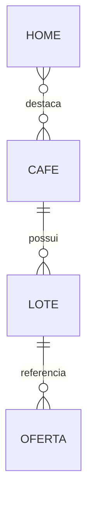

# Catálogo editorial — arquitetura

## Entidades e fronteiras

- **Café**: identidade duradoura (`id`, `slug`, nome, apresentação, cor e foto). A URL `/cafes/{slug}/` pertence ao café, não a uma safra ou oferta. `primaryLotId` escolhe a primeira ficha exibida; `sortOrder` ordena o catálogo.
- **Lote**: rastreabilidade e características que podem mudar: código, produtores, origem, variedade, perfil, notas, acidez, corpo, torra, pontuação e preparos. `coffeeId` liga ao café. Sem limite de lotes por café. Campos não confirmados permanecem nulos/listas vazias.
- **Oferta editorial**: referência de SKU a um lote (`lotId`), moeda e valores comerciais confirmados, todos opcionais quando desconhecidos. Várias ofertas podem referenciar o mesmo lote. Não é uma autorização para comprar ou reservar estoque.
- **Home**: textos e lista ordenada `featuredCoffeeIds`; não há nomes ou contagens de cafés fixos no componente. A lista pode estar vazia. Destaques de cafés em rascunho/arquivados são omitidos, sem substituição automática.

Cada registro tem um arquivo JSON em `content/coffees/`, `content/lots/` ou `content/offers/`. O nome do arquivo deve ser `{id}.json`. `content/home.json` guarda a seleção editorial. As coleções podem estar vazias. Arquivos `.gitkeep` apenas preservam pastas vazias.

## Pipeline

1. `lib/content-loader.ts` lê os arquivos no **build**, sem chamadas ao CMS no navegador.
2. `lib/content-schema.ts` valida estrutura e relações com Zod: IDs/slugs/códigos/SKUs únicos, referências existentes, lote principal do café correto, status, valores numéricos e caminhos de mídia. Arquivo ausente/inválido interrompe o build. O `prebuild` roda a validação antes do Next.
3. `lib/catalog-model.ts` produz somente projeções públicas. Cafés, lotes e ofertas em rascunho não entram nos componentes públicos. Ofertas também exigem café e lote publicados. `CoffeeView` é uma projeção para apresentação, não uma quarta entidade persistida.
4. Páginas server passam essas projeções para catálogo e ficha. Componentes não importam arquivos editoriais nem o carregador de filesystem.
5. `generateStaticParams` gera as URLs de cafés publicados e arquivados. O Next exporta HTML e payloads estáticos; GitHub Pages os hospeda com `/CURA-CAF-/`.

O carregador é a fronteira para um futuro CMS/API: outro adaptador pode retornar o mesmo `Content`, mas deve executar o mesmo schema e política de publicação. Não é necessário mudar componentes ou introduzir servidor Next em produção.

## Publicação e arquivamento

Todos os tipos têm `draft`, `published` e `archived`. Publicação editorial e implantação são etapas separadas: mudar o status não altera o site já publicado. É preciso validar, integrar a alteração e concluir um novo deploy.

- Café publicado sem lotes publicados permanece navegável, com dados explicitamente a confirmar.
- Um lote principal não publicado não é mostrado: usa-se o primeiro lote publicado por `sortOrder` e, em empate, ID. Se nenhum existir, mostra-se o estado sem lote.
- Lotes arquivados e suas ofertas somem da ficha e dos filtros, sem apagar o histórico no Git.
- Café arquivado sai do catálogo e da Home, mas mantém uma página informativa na URL original, sem oferta e com `noindex`.
- Café em rascunho não gera URL. Depois da primeira publicação, usar **arquivar**, não voltar a rascunho, para preservar o endereço.
- Não alterar IDs/slugs após a publicação. Renomear o nome visível é permitido. Mudanças excepcionais de URL exigem uma migração e páginas de compatibilidade; GitHub Pages não fornece redirects Next de servidor.

## Filtros e lotes

Perfil, torra e preparo são derivados de todos os lotes publicados dos cafés publicados, deduplicados e ordenados em português. A busca considera nome/apresentação do café e código/notas/produtores de seus lotes. Filtros são combinados com AND **no mesmo lote**; não basta um lote ter a torra e outro ter o perfil. A contagem é de cafés, não de ofertas. O cartão resume o lote principal; a ficha oferece seletor para consultar os demais lotes publicados.

A ficha de cada café lista todos os outros cafés publicados para descoberta, inclusive quando existem zero ou apenas um café no catálogo, sem supor “o outro produto”.

## Fotos

`media` é nulo enquanto não houver foto autorizada; nesse caso permanece o estudo gráfico explicitamente identificado. Uma foto contém `src`, `alt` e `credit`. Uploads locais usam `public/media/`, com caminhos `/media/...` e extensões raster permitidas (JPEG, PNG, WebP, AVIF). O build verifica a existência do arquivo. Texto alternativo e crédito são obrigatórios quando há foto. Conteúdo textual é renderizado por React, sem HTML editorial executável.

`CoffeeArt` usa `next/image` sem otimização de servidor e prefixa o caminho público conforme o build Pages. A imagem é contida no espaço estável do cartão/ficha; não há carregamento remoto obrigatório. Autorização e fidelidade da imagem dependem de revisão humana, não podem ser provadas pelo schema. A validação verifica existência/caminho, não a autenticidade ou qualidade do arquivo.

## Comércio

O conjunto real de ofertas continua **vazio**, sem preços ou estoque fictícios. Valores vazios são normalizados para `null`, nunca para zero. Se futuramente forem cadastradas ofertas editoriais, a ficha apresenta SKU e atributos confirmados do lote selecionado, mas a ação segue desabilitada e avisa que a disponibilidade depende de integração comercial. Quantidades editoriais não são anunciadas como estoque em tempo real.

`lib/commerce.ts` define somente referência de linha por `offerId` e quantidade. Habilitar carrinho/checkout exige provedor real, validação de preço/estoque/variantes, frete, pagamento, pedidos e tratamento de erros. O CMS não será a fonte autoritativa de estoque transacional.

## Validação

- `npm run validate:content`: schema, relações, nomes de arquivo e existência de fotos.
- `npm run test:unit`: migração do snapshot original, zero/um/muitos cafés, múltiplos lotes/ofertas, filtros, isolamento de rascunhos, Home e configuração do CMS.
- `npm run test:scenarios`: cria conteúdo técnico **fora do checkout**, faz um export de teste e testa seleção de lotes, foto, Home configurável, ofertas sem valores e arquivamento em desktop/mobile. Verifica que sentinelas de rascunho não aparecem nos artefatos. Também exporta um catálogo completamente vazio e executa suas regressões. Remove a imagem técnica temporária e refaz o export real no final, inclusive após falha de cenário. Não executar em paralelo com dev/build/test.
- `npm test`: unidades + regressões Playwright dos dados reais sobre o export final.
- `npm run lint` e `GITHUB_PAGES=true npm run build`: checks de código e exportação.

`CURA_CONTENT_ROOT` é uma entrada exclusiva de teste/adaptador build-time para um diretório com `content/` e `public/`. Não configurá-la no ambiente de produção. Rascunhos não são emitidos no site, mas os JSON continuam legíveis para quem tem acesso ao repositório; um repositório público não serve para conteúdo confidencial.

As regressões dos dados vivos derivam expectativas do conteúdo publicado: uma edição legítima pelo CMS não exige atualizar nomes/contagens nos testes. O snapshot legado e o adaptador de migração ficam isolados em `tests/fixtures/legacy-catalog.json` e `scripts/lib/migrate-legacy.ts`; comprovam a conversão original sem obrigar os registros ativos a manterem eternamente os mesmos valores.

### Catálogo completamente vazio no Next 15

O Next 15.5 exige ao menos um parâmetro em `generateStaticParams` para `output: export`, mesmo quando não existe café público. Nesse único caso, o adaptador fornece o parâmetro técnico reservado `_catalogo-vazio` (inválido como slug editorial), cuja página executa `notFound()`. O `postbuild` remove esse diretório gerado de `out/`, para que não exista uma página pública fictícia e o host responda 404. Sempre executar `npm run build`, que inclui validação e finalização, em vez de chamar `next build` diretamente. Os testes fazem um build com zero registros, verificam ausência desse artefato e executam as regressões sobre o catálogo vazio. Reavaliar essa compatibilidade ao atualizar o Next.

## V1: editorial, descoberta e seleção local

`content/site.json` e `lib/editorial.ts` adicionam schema próprio para textos de Home, curadoria, história, Clube, quiz e rodapé; a validação de conteúdo inclui ambos os schemas. `lib/quiz.ts` cruza preferências no mesmo lote publicado, sem escores de gosto inventados, dados pessoais ou API externa. Resultados apontam para `?lote=<id>`; a ficha valida esse ID e atualiza os atributos do lote correspondente.

`SelectionProvider` mantém IDs de ofertas publicadas na sessão, com fallback em memória se o armazenamento estiver bloqueado. IDs inválidos/retirados são descartados ao carregar. A revisão do carrinho recebe somente registros públicos e permite remover itens; não há quantidade, subtotal, reserva ou checkout. O contexto não é um backend transacional e não garante estoque/preço em tempo real.

A edição editorial em `main` pelo Pages CMS foi preservada por instrução da equipe. Código continua em branch/PR. O PR de apresentação não modifica permissões nem executa publicação direta.
